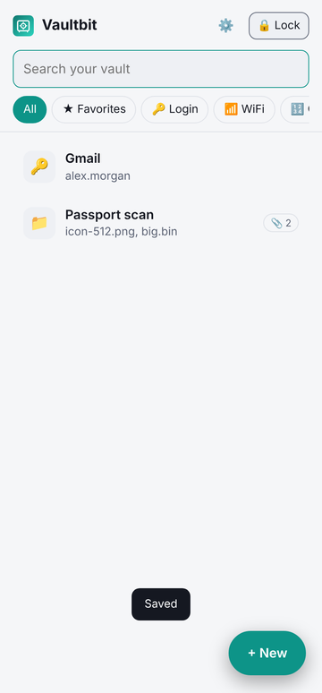
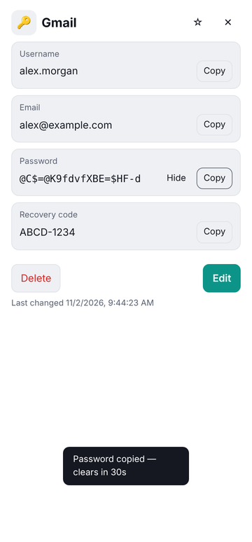
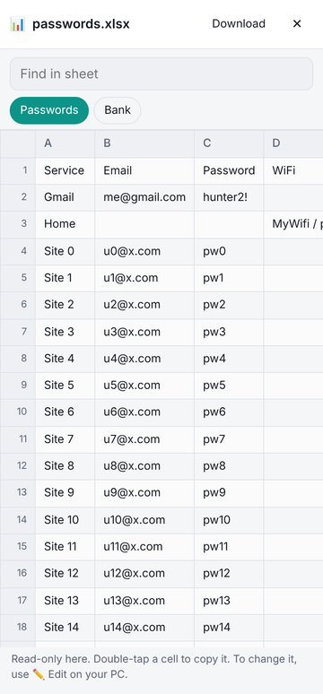
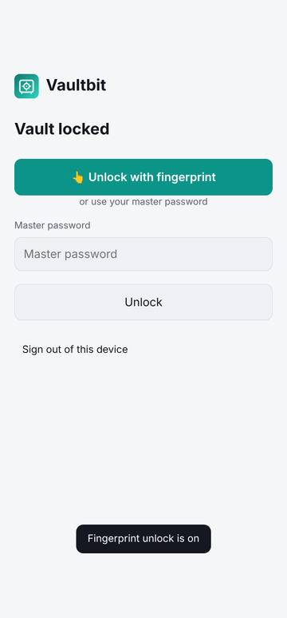
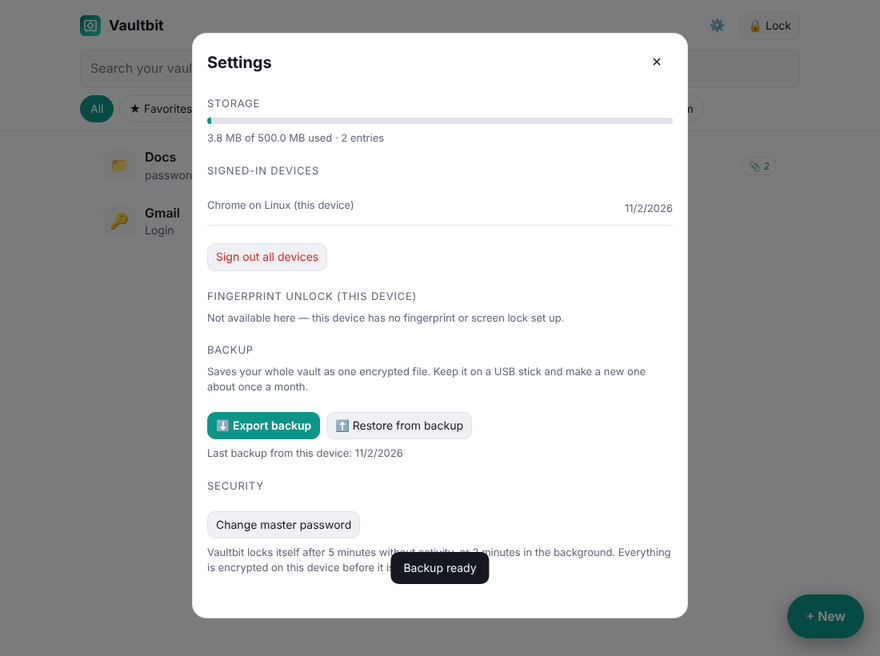

# Vaultbit

A personal, **zero-knowledge** vault for passwords, codes, Wi-Fi details, notes and files. It runs as an installable web app (PWA) on phone, laptop and desktop, and is hosted for free on **Cloudflare Workers + D1**.

Everything is encrypted on the device **before** it is uploaded. The server only ever stores ciphertext and never sees the master password.

<p>
  
  
  
  
</p>

## Features

- **Flexible entries.** Logins, Wi-Fi, PINs/codes, secure notes or custom entries, each with any fields you want (visible or hidden), plus a strong password generator.
- **Encrypted file storage.** Attach any file type, up to 100 MB each. Files are split into parts and each part is encrypted separately.
- **Built-in viewer.** Excel/CSV (sheet tabs and search), PDF, images, text, audio and video open inside the app, decrypted in memory only, with nothing written to disk.
- **Edit on desktop.** ✏️ Edit saves a working copy and 💾 Save changes uploads the new version, using the File System Access API. All devices pick up the change automatically.
- **Two-step sign-in.** A new device needs the master password **and** a 6-digit code sent by email.
- **Fingerprint / Windows Hello unlock.** Uses a passkey with the WebAuthn **PRF** extension, so the unlock secret never leaves the device's secure hardware.
- **Encrypted backup and restore.** Export the whole vault as one `.vbk` file. Restoring merges without duplicates and works even into a brand-new vault.
- **Auto-lock** after inactivity, clipboard auto-clear, sign-out of all devices, master password change.
- **Installable as an app.** Install it on Android, Windows or macOS from Chrome or Edge, and it opens in its own window.

## How the security works

```
master password ──Argon2id (64 MiB, 3 passes, random salt)──► master key
master key ──HKDF──► ① encryption key   (never leaves the device)
               └────► ② login proof     (sent to server, stored only as a SHA-256 hash)

random 256-bit vault key ──encrypted with ①──► stored on server as "wrapped key"
every entry / file part  ──AES-256-GCM with vault key──► stored on server
```

- **Zero knowledge.** The server stores the salt, the wrapped vault key and AES-GCM ciphertext. Without the master password none of it can be decrypted.
- **Tamper-proof.** Every ciphertext is bound to its ID with AES-GCM associated data (`item:<id>`, `file:<id>:<part>:<total>`), so blobs can't be swapped or reordered.
- **Password changes are instant.** Only the wrapped key is re-encrypted; the data stays as it is. Other sessions are signed out.
- **Server-side protections:**
  - email codes are hashed, expire after 10 minutes and are burned after 5 wrong tries
  - sign-in attempts are rate limited per IP and globally
  - sessions are random 256-bit tokens, stored hashed and expiring after 30 days
- **Browser hardening.** A strict Content-Security-Policy (no inline scripts or styles, no third-party origins), `frame-ancestors 'none'`, HSTS and `no-store` on every API response.
- **Fingerprint unlock.** A passkey's PRF output (released only after biometric verification) derives a key that wraps a copy of the vault key, stored on that device only.

> There is intentionally **no password recovery**. If the master password is lost, the data can't be decrypted by anyone.

## Tech stack

| Part | Tech |
|---|---|
| Backend | Cloudflare Workers (JavaScript), D1 (SQLite) |
| Frontend | Vanilla JavaScript PWA, no framework and no build step |
| Crypto | Web Crypto API (AES-256-GCM, HKDF, SHA-256), Argon2id via [hash-wasm](https://github.com/Daninet/hash-wasm), WebAuthn PRF |
| Email codes | [Resend](https://resend.com) API |
| Viewers | [SheetJS](https://sheetjs.com) (spreadsheets), [PDF.js](https://mozilla.github.io/pdf.js/) |
| Tests | Node end-to-end API test plus Playwright browser tests (104 checks) |

## Project layout

```
src/worker.js        API: auth, email codes, sessions, encrypted entries and file parts, rate limits
public/app.js        the whole client: crypto, UI, viewer, edit flow, fingerprint, backup/restore
public/sw.js         service worker (caches the app shell only, never vault data)
schema.sql           D1 tables
setup/setup.mjs      one-command setup and deploy (used by deploy.bat)
tests/               API and browser tests
```

## Deploy your own

You need a free Cloudflare account, a free Resend account and Node.js 18+.

```bash
npm install
npm run deploy          # or double-click deploy.bat on Windows
```

The setup script:
1. logs in to Cloudflare
2. creates the D1 database and tables
3. asks for the email that receives login codes
4. stores the Resend API key as an encrypted Worker secret
5. deploys the app and prints its URL

Run it again any time to publish updates.

> On Resend's free plan without your own domain, codes can only be sent to the email you signed up to Resend with. That's fine here, because the vault has one owner.

## Running the tests

```bash
pip install playwright openpyxl reportlab && python -m playwright install chromium
npm test
```

The tests start a local server in dev mode, where email codes are shown instead of sent, and cover:

- sign-up and sign-in, including wrong codes and passwords and brute-force limits
- end-to-end encryption, including checks that the server copy is unreadable
- large multi-part files
- the viewer, the edit flow and fingerprint unlock (with a virtual authenticator)
- backup and restore, including into a fresh vault with a different password
- two devices syncing



## License

MIT. See [LICENSE](LICENSE). Bundled third-party libraries keep their own licenses; see [THIRD_PARTY.md](THIRD_PARTY.md).
